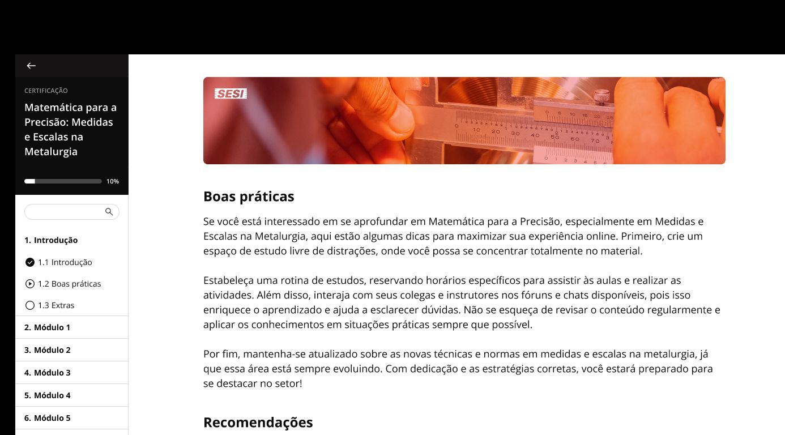
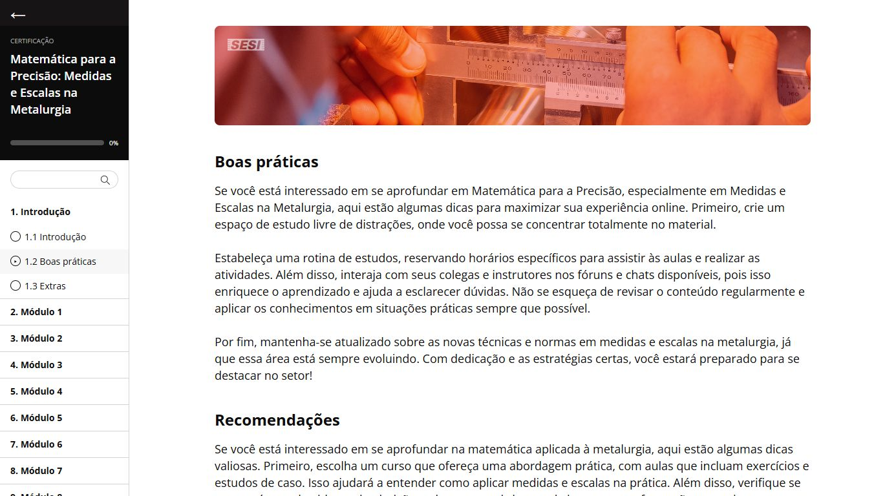

# AVA — primeira implementação local

**Regra atual:** navegação livre e conclusão validada por aula, conforme a última seção. As revisões anteriores abaixo são históricas; o bloqueio sequencial foi substituído a pedido do usuário. Todas as versões continuam exclusivamente locais.

Referência inspecionada: [fluxo 03. AVA, frame 6017:1042](https://www.figma.com/proto/YB0o91nnOEB5bXXCtmy5s6/-TEST-DEV--SESI-Ind%C3%BAstria?node-id=6017-1042&page-id=3%3A2&scaling=min-zoom&content-scaling=fixed). Inspeção em 24/10/2026. Alterações ainda locais; não publicadas no Render nem incluídas no ZIP anterior.

## Observado no Figma

Lateral de 200px, faixa de retorno, nome do curso, progresso ilustrativo de 10%, pesquisa, Introdução com três itens, seis módulos fechados. Área branca com banner institucional, logo SESI, Boas práticas e Recomendações. Banner observado com cerca de 922 × 154px na área útil de 1386px; conteúdo com fonte aproximada de 18/26px e títulos 24/32px. Medidas da renderização, sem Dev Mode ou propriedades exportadas.

Cliques em Introdução e Módulo 1 não revelaram outras telas/conteúdos. Não foi observada variante móvel nem programas AVA próprios dos outros cinco cursos. Não se afirma que os estados interativos implementados foram fornecidos pelo protótipo.

| Referência — área útil 1386 × 768 | Aplicação — mesma área útil |
| --- | --- |
|  |  |

## Implementado

- `/ava`: seleção dos cursos retornados pela API; acessível pelo Header, Área do aluno. Essa seleção é adaptação, sem frame oficial observado.
- `/ava/{id}?aula={chave}`: mesma interface para os seis cursos, sem cópia de páginas ou respostas mockadas.
- Nome, módulos, aulas e descrições vêm de `GET /api/cursos/{id}`, com ordenação por ordem e ID. Nenhum backend, seed ou banco alterado nesta rodada.
- Introdução, Boas práticas e Extras são uma seção editorial compartilhada; o texto de Boas práticas/Recomendações parte do único frame observado e é contextualizado por curso. Extras organiza a revisão, sem downloads inventados.
- Busca local nos módulos/aulas já recebidos, sem acentos, com vazio e limpeza; expansão dos módulos; aula atual indicada; navegação anterior/próxima e URL reproduzível.
- Conclusão explicitamente marcada pelo usuário, reversível. Progresso calculado sobre todas as aulas disponíveis, incluindo as três introdutórias, começando em zero. Visitar uma página não equivale a concluí-la.
- `ProgressRepository` separa persistência e interface. Implementação atual usa localStorage versionado por curso, normaliza dados e ignora chaves removidas/duplicadas. JSON inválido ou storage bloqueado não derruba a tela; falha de gravação é informada.
- Menu móvel com Escape e retorno do foco, fechamento ao selecionar aula, nomes acessíveis, progresso nativo e links por teclado. Sem dependências novas.

## Diferenças e limites explícitos

- Sem autenticação, identidade simulada, matrícula ou progresso no servidor. O navegador compartilhado compartilha esse progresso; limpeza dos dados do site o remove. Para contas reais, substituir o repositório por API autenticada, com autorização do aluno em cada operação e persistência por aluno/curso/aula. Essa etapa ainda não foi implementada.
- O progresso não é fixado em 10%. Metalurgia usa os dez módulos/trinta tópicos atuais da API, além da introdução; outros cursos usam seus próprios dois módulos/quatro aulas, além da introdução. Os rótulos compactos Módulo N preservam o título real no nome acessível/tooltip e no conteúdo selecionado.
- Textos de aulas são as descrições já cadastradas; não representam cursos didáticos completos. Não há vídeos, provas, fóruns, chats, suporte, arquivos ou emissão de certificados. Menções a esses recursos no texto de Boas práticas são conteúdo editorial do protótipo, não funcionalidades disponíveis.
- Para os outros cursos, reutilizadas as fotografias oficiais já associadas a cada curso, sem tratar a fotografia de Metalurgia como se representasse todos os temas.
- Layout móvel, seleção de cursos, controles de conclusão/paginação e mensagens de recuperação são adaptações funcionais. Não se declara fidelidade pixel a pixel; recorte do banner e detalhes tipográficos ainda admitem revisão humana.
- Home, catálogo, filtros, detalhes e matrícula demonstrativa preservados. Adicionado link explícito Acessar AVA do curso aos detalhes; matrícula continua desabilitada.

## Validação observada

- Build TypeScript/Vite aprovado.
- 28 testes frontend aprovados, cinco novos focados no AVA: ordenação sem mutação, busca, progresso válido, persistência isolada/corrompida/bloqueada e contextualização.
- Navegador com API local e PostgreSQL local de revisão: seis cursos abertos em 1440px e 390px, sem overflow horizontal. Metalurgia: 11 seções/33 itens incluindo introdução; demais cursos: 3 seções/7 itens.
- Curso 6: conclusão de Boas práticas gerou 14%, persistiu após reload e foi desmarcada ao terminar o teste. Aula real `aula-611` mostrou título/descrição da API; Enter em próxima aula navegou para `aula-612`.
- Busca resistencia encontrou o módulo Resistência; termo inexistente mostrou vazio; limpeza restaurou a navegação. Menu móvel fechou por Escape e por seleção, com foco no artigo. Curso 999999 e aula inexistente mostraram recuperação, sem sucesso falso. Nenhum erro registrado no console da aba consultada.
- Não testados dispositivo físico, leitor de tela real, indisponibilidade artificial da API ou sincronização entre abas. Testes backend não repetidos, pois não houve impacto no backend.

Evidências em `docs/evidencias/ava/`: capturas de referência, comparação 1386px, desktop 1440px, mobile 390px e `validacao-seis-cursos.json`. Sem commit, push, deploy, alterações Neon ou recriação do ZIP.

## Revisão — progressão obrigatória

- Entrada em Introdução. Apenas etapas concluídas e a primeira pendente são acessíveis; sidebar, busca, próxima aula e URL direta respeitam a mesma regra. Conteúdo bloqueado não é renderizado. Isso é controle do protótipo cliente, não autorização segura de servidor.
- Texto: o fim do conteúdo deve alcançar ou passar o limite inferior do viewport. Se o texto couber inteiro na tela, não se exige rolagem artificial. Chegar ao fim não comprova leitura/compreensão; apenas cumpre o critério de interface solicitado.
- Perguntas: Extras e a última aula de cada módulo têm uma pergunta demonstrativa. Selecionar não basta: é obrigatório validar a resposta correta; erro permite nova tentativa e continua bloqueando. Perguntas editoriais compartilhadas/contextualizadas, não avaliações oficiais do SESI nem telas observadas no Figma.
- Vídeo: primeira aula de cada módulo tem simulação de 12 segundos com `video-thumb.png`, imagem oficial existente, sem novo asset, áudio ou arquivo de vídeo real. Reproduzir/pausar e progresso temporal funcionam. Sem avanço manual; tempo pausado/aba oculta não é creditado. O controle só habilita após fim do texto. Ao trocar de aula/recarregar sem concluir, a evidência temporária deve ser refeita.
- Concluir etapa exige todos os critérios presentes. Não conclui por abertura nem por seleção de alternativa. A próxima aula é liberada após clicar em Concluir etapa.
- Refazer a partir desta etapa revoga também todas as conclusões posteriores, preservando o encadeamento.
- Persistência `sesi.ava.progress.v2.course.{id}`, mantendo v1 intacta e ignorada. O progresso antigo não tinha validação e não libera o novo percurso. Carregamento aceita somente o prefixo contínuo de aulas válidas. Continua sem conta, backend de progresso ou sincronização; o usuário pode alterar os dados locais. Para uso real, validar pré-requisitos, respostas e progresso no servidor autenticado.
- Sem mudanças em API, banco, seed, Neon, infraestrutura ou publicação. Aula/descrição continuam vindo da API; perguntas e simulações são exemplos explicitamente identificados.

Build e 32 testes frontend aprovados, incluindo acesso por pré-requisitos, evidências obrigatórias, revogação em cascata e isolamento do progresso antigo. Validações manuais e capturas desta revisão são registradas em `docs/evidencias/ava/` com prefixo `progressivo-`.

### Verificações manuais desta revisão

- Curso 2, desktop 1440px: URL direta para Boas práticas inicialmente bloqueada; recuperação levou à Introdução. Concluir a primeira etapa liberou somente a próxima.
- Boas práticas: botão de conclusão desabilitado no topo e habilitado após rolar ao final. Mobile 390px, curso 3: mesmo resultado, sem overflow.
- Extras: alternativa incorreta manteve bloqueio; selecionar a correta sem validar também manteve; validar a correta habilitou Concluir etapa. Mobile: validação por Enter confirmada.
- Simulação da primeira aula do módulo: conclusão desabilitada antes da reprodução; pausa manteve o contador em 0,2152s entre duas observações; término em 12s habilitou a conclusão. Segunda simulação também concluída durante o percurso.
- Curso 2: todas as sete etapas concluídas pela interface, duas simulações e três perguntas. Indicador 100% e Curso concluído mantidos após reload. Refazer a Introdução voltou a 0%, e URL direta para Extras passou a bloqueada. Cursos 2 e 3 deixados com 0% ao terminar os testes pela própria ação de refazer.
- Menu mobile com seis itens bloqueados e sem overflow; nenhum erro de console na aba consultada. Correção real durante a inspeção: estilo global de input ampliava os radios e deslocava textos; aplicado tamanho de 18px, com nova captura aprovada visualmente.
- A troca de abas no navegador de teste não mudou `document.hidden` (permaneceu false). Portanto, não foi possível comprovar manualmente a pausa automática por aba oculta; essa regra, baseada em visibilitychange, precisa de revisão no navegador comum. Pausa manual e término foram efetivamente observados.
- Não testada reprodução de mídia real, pois o exemplo autorizado é uma imagem estática temporizada, explicitamente identificada. Sem teste físico ou leitor de tela real.

Capturas: `progressivo-video-validado-1440.jpg`, `progressivo-curso-concluido-1440.jpg`, `progressivo-url-bloqueada-1440.jpg`, `progressivo-leitura-390.jpg`, `progressivo-pergunta-390.jpg`, `progressivo-menu-bloqueado-390.jpg`.

## Revisão atual — acesso livre e perguntas com feedback

Pedido do usuário: remover cadeados e pré-requisitos entre aulas; exigir critérios em todas as aulas para concluir o curso; melhorar perguntas e impedir troca após acerto.

- Todas as aulas acessíveis pelo menu, busca, URL e anterior/próxima, mesmo pendentes. Cadeados e mensagem Etapa bloqueada removidos.
- Requisitos de leitura, pergunta correta validada e reprodução continuam por aula, conforme o conteúdo presente. Visitar/navegar não conclui nada.
- Conclusões podem ocorrer em qualquer ordem, são preservadas pelo mesmo storage v2 e normalizadas por IDs válidos. Nenhum progresso válido v2 descartado; v1 sem validação continua ignorado.
- Curso concluído apenas quando todas as chaves estão concluídas. Percentual nunca arredonda a 100% faltando aula. Na última aula, havendo pendências, a ação Revisar aulas pendentes leva à primeira ainda não finalizada.
- Refazer esta aula remove somente a conclusão escolhida; preserva todas as demais. A conclusão global deixa de valer se alguma aula for refeita.
- Perguntas com alternativas em cartões, identificação A/B/C, estados de seleção/erro/acerto, ícone e explicação contextual. Após erro, permite outra tentativa sem concluir. Após acerto, fieldset desabilitado e reducer também recusa trocas; Responder novamente é a ação explícita para limpar a resposta e voltar a pendente. Aula já concluída exibe a resposta validada; usar Refazer esta aula para reiniciá-la.
- Layout das perguntas é uma adaptação funcional, não um frame oficial observado do Figma. Sem alteração de Home, catálogo, API/banco, assets, infraestrutura ou publicação.

Validação: build aprovado e 34 testes frontend, incluindo dois de transição das respostas, conclusão fora de ordem, persistência, todas as aulas necessárias e revogação isolada. No navegador, curso 2: acesso direto a Extras com 0%; erro manteve Concluir etapa desabilitado; acerto travou alternativas; Responder novamente as liberou e voltou a desabilitar conclusão. Extras concluída antes das outras persistiu após reload em 14%, com resposta travada. Concluir também a última aula levou a 29%, sem Curso concluído e com Revisar aulas pendentes. Refazer apenas a última preservou os 14% de Extras. Teste encerrado em 0% pela própria interface, removendo só as conclusões feitas nesta revisão. Desktop 1440px e mobile 390px sem overflow ou cortes na amostra; nenhum erro no console da aba consultada.

Capturas atuais: `pergunta-feedback-1440.jpg` e `pergunta-feedback-390.jpg` em `docs/evidencias/ava/`. A suíte backend não foi repetida (sem impacto); reprodução/rolagem mantidas, sem repetir percurso completo já observado na revisão anterior. Limitações de storage local, simulação de vídeo e pausa por aba oculta permanecem. Sem commit, push, deploy ou ZIP.

## Refinamento do player demonstrativo

A pedido do usuário, substituída a apresentação de imagem com controles soltos por quadro 16:9 de até 860px, com play central, gradiente de contraste, identificação Demonstração, logo oficial, controles integrados, tempo 0:00/0:12, progresso vermelho e estado final. Sem controles falsos de volume, fullscreen ou busca. A indicação Sem áudio é informativa, não um botão. Sem novos assets, mídia externa ou alteração da lógica de contabilização: continua imagem estática temporizada de 12 segundos, não vídeo real.

Build aprovado, 11 testes focados aprovados. Navegador: play central, pausa por Enter (0,2129s, conclusão ainda bloqueada), retomada e término em 12s habilitando Concluir etapa. Em 390px, quadro 350px e controles 334px, sem overflow; captura do estado final. Sem conclusão persistida durante este teste. Capturas player-revisao-1440.jpg e player-revisao-390.jpg. Mantidas limitações anteriores da simulação e de visibilidade da aba. Sem backend, banco, dependências, commit, publicação ou ZIP.
